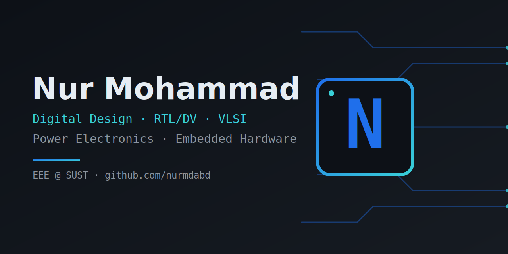

  

### Hi, I'm Nur 👋

Final-year EEE undergrad at **Shahjalal University of Science and Technology (SUST)**, Bangladesh.

- 🔹 **Digital design & VLSI:** intern at **Asmicore Semiconductor**, training in the RTL-to-GDSII flow
- 🔹 **Power electronics:** phase-shift-controlled DC–DC converters, MOSFET gate drive
- 🔹 **Embedded & hardware:** CPU/ISA design, Arduino, STM32
- 🔹 **Also into:** solar PV and renewable energy systems

---

### Projects

| Project | What it is |
|---------|------------|
| [8-Bit-BreadBoard-Computer](https://github.com/nurmdabd/8-Bit-BreadBoard-Computer) | 8-bit computer from discrete logic ICs with a custom 16-instruction ISA and EEPROM control logic |
| DAB DC–DC Converter | Dual Active Bridge bidirectional converter with phase-shift control, modelled in MATLAB/Simulink and built in hardware |
| CMOS Voltage Reference *(ongoing)* | All-MOSFET subthreshold PTAT/CTAT reference in Cadence Virtuoso |
| [engineering-docs](https://github.com/nurmdabd/engineering-docs) | Engineering notes and documentation |
| [Link-to-url-file-generator](https://github.com/nurmdabd/Link-to-url-file-generator) | Web tool that turns any link into a `.url` file |
| [xournal-plugin](https://github.com/nurmdabd/xournal-plugin) | Plugin for Xournal++ (Lua) |
| [Cover-Page](https://github.com/nurmdabd/Cover-Page) | Cover page template (LaTeX) |

---

### Tools

`MATLAB/Simulink` · `Cadence Virtuoso` · `Proteus` · `Python` · `C` · `8086 Assembly` · `LaTeX`

  <a href="https://www.linkedin.com/in/nurmdabd">LinkedIn</a>

